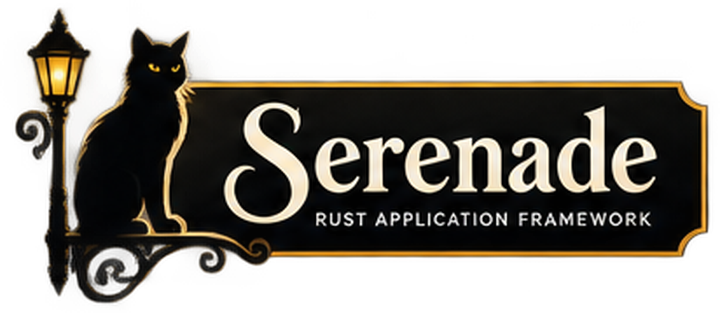
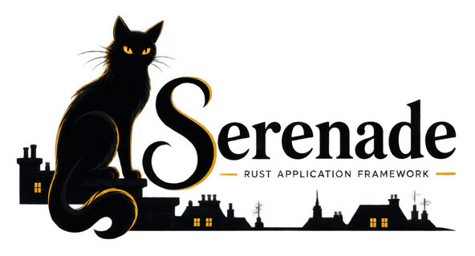

# **Serenade**

<p align="center">
  
</p>

<p align="center">
  <strong>Rust application framework.</strong>
</p>

<p align="center">
  <a href="https://github.com/Interchouette-ITC/Serenade/actions/workflows/ci.yml"></a>
  <a href="https://codecov.io/gh/Interchouette-ITC/Serenade"></a>
</p>

Symfony-oriented application framework for Rust. **Not** Rails-style, **not** Django-style: composable kernel components and bundles around which you build products.

Serenade does **not** impose SQLx, SeaORM, Diesel, or Actix vs Axum for your product HTTP surface. It provides architecture, contracts, and reusable components; the application chooses persistence and UI stacks. Cargo stays the package manager; Serenade owns composition (bundles, recipes, console).

Website: <https://serenade.rs> | Guides: <https://docs.serenade.rs>

**Primary consumer:** [rustashop](https://github.com/Interchouette-ITC/rustashop) - commerce product on Serenade, the way [PrestaShop](https://www.prestashop.com/) builds on [Symfony](https://symfony.com/).

## Use Serenade

Applications depend on the **`serenade-framework`** facade and enable the components they
need with Cargo features:

```toml
[dependencies]
serenade-framework = { version = "1.0.0", features = ["http-actix", "validation"] }
```

```rust
use serenade_framework::prelude::*;

let mut app = App::new(Environment::Prod);
app.boot()?;
```

The default build is only the foundations (kernel, config, DI, events): no web server,
database, Leptos, or Rangular. Feature list and module map:
[docs.rs/serenade-framework](https://docs.rs/serenade-framework). A complete consumer lives
in [`../examples/framework-consumer`](../examples/framework-consumer).

### Crate organization

| Layer | Packages |
| --- | --- |
| Facade | `serenade-framework`: curated re-exports behind features |
| Foundations | `serenade-kernel`, `serenade-config`, `serenade-di`, `serenade-event`, `serenade-bundle`, `serenade-contracts` |
| Components | `serenade-http`, `serenade-session`, `serenade-security`, `serenade-validator`, `serenade-messenger`, `serenade-mailer`, `serenade-view`, `serenade-form`, … |
| Adapters | `serenade-http-actix`, `serenade-http-axum`, reqwest (`http-client-reqwest`), SMTP / ESP mail, Redis stores, Leptos SSR / hydration |
| Tooling | `serenade-cli` (the `serenade` executable), `serenade-testing`, `serenade-profiler` |

Every `serenade-*` crate is published independently on crates.io and can be used directly;
crates outside the facade surface (for example `serenade-cache`, `serenade-workflow`,
`serenade-translation`) are added as their own dependencies. All crates share one version.

### CLI

The `serenade` executable comes from the **`serenade-cli`** package (the crates.io package
named `serenade` is unrelated):

```bash
cargo install serenade-cli --locked --bin serenade
serenade new demo
```

Prebuilt archives with SHA-256 checksums and build provenance attestations are attached to
each [GitHub release](https://github.com/Interchouette-ITC/Serenade/releases).

### Templates with Rangular

Serenade views are engine neutral. To author templates with
[Rangular](https://crates.io/crates/rangular), add `rangular = "1.1"` and
`rangular-build = "1.1"` (build dependency) to the application; Serenade crates never depend
on it. See [`../docs-dev/VIEW.md`](../docs-dev/VIEW.md) and
[`../examples/demo-universal`](../examples/demo-universal).

### Supported Rust

The minimum supported Rust version is **1.100** (`rust-version` in the root `Cargo.toml`),
checked in CI. Raising it is a minor-version change and is noted in the
[changelog](CHANGELOG.md).

## What you get today

| Piece | Role |
| --- | --- |
| Kernel / lifecycle | Boot, environment, bundle order, shutdown |
| DI + events | Container, tagged services, sync dispatcher |
| Config | TOML-first packages (`config/packages/*.toml`); YAML still loadable |
| Contracts | Repository / `UnitOfWork` traits (no DB driver in core) |
| HTTP + routing | Framework-agnostic request path + matcher |
| HTTP adapters | Actix (`from_actix` / `to_actix` / `dispatch` / **`listen(addr, AsyncHttpKernel)`**) and Axum |
| Console | `bin/console` analogue (`serenade:about`, `debug:container`, `--interactive`) |
| Scaffolding CLI | `serenade new` / `recipe` / **`serenade tui`** (ratatui recipe picker) |
| Make aliases | `make serenade`, `make tui`, `make console`, `make ci`, … |

```text
App (domain + adapters)
  → Serenade kernel / DI / events / HTTP / console
      → your ORM choice (SQLx, SeaORM, …) implementing contracts
      → your HTTP choice (Actix or Axum adapters)
```

Business rules run in the **domain / use case before** `Repository::save`. Technical fields (`updated_at`, …) stay in the app adapter or ORM hooks. See [`../docs-dev/PERSISTENCE.md`](../docs-dev/PERSISTENCE.md).

## Quick start (this repo)

```bash
git clone https://github.com/Interchouette-ITC/Serenade.git
cd Serenade
make ci          # lint + test + doc (stable Rust)
make help        # all targets
```

### Scaffolding CLI

```bash
make serenade ARGS='--help'
make serenade ARGS='new demo --path /tmp'
make recipe-list
make tui ARGS='--no-cargo'          # guided recipe picker (TTY)
make serenade ARGS='recipe apply security --no-cargo'
```

Cargo remains the package manager (`cargo add` on apply unless `--no-cargo`). Details: [`../docs-dev/RECIPES.md`](../docs-dev/RECIPES.md).

### Demo console

```bash
make console ARGS='serenade:about'
make console ARGS='debug:container --plain'
make console ARGS='--interactive'   # rustyline REPL, ~/.serenade_history
make demo                           # sample app boot (prints routes / services)
```

Console docs: [`../docs-dev/CONSOLE.md`](../docs-dev/CONSOLE.md).

### Actix listen helper

```rust
use serenade_http::{AsyncHttpKernel, Request, Response};
use serenade_http_actix::listen;

let kernel = AsyncHttpKernel::from_sync(|_request: &mut Request| {
    Ok(Response::text(200, "ok"))
});
// listen("127.0.0.1:8080", kernel).await?;
```

See [`../docs-dev/KERNEL.md`](../docs-dev/KERNEL.md).

## Docs

| Doc | Topic |
| --- | --- |
| [`../docs-dev/README.md`](../docs-dev/README.md) | Developer docs index |
| [`../docs-dev/VISION.md`](../docs-dev/VISION.md) | Symfony analogy, non-goals |
| [`../docs-dev/KERNEL.md`](../docs-dev/KERNEL.md) | Components + HTTP adapters |
| [`../docs-dev/CONSOLE.md`](../docs-dev/CONSOLE.md) | Console Application |
| [`../docs-dev/RECIPES.md`](../docs-dev/RECIPES.md) | Flex-like recipes + `serenade` CLI |
| [`../docs-dev/BUNDLES.md`](../docs-dev/BUNDLES.md) | Bundles and extensions |
| [`../docs-dev/WASM.md`](../docs-dev/WASM.md) | Wasm host plumbing (wasmtime CM + Wasmer WASIX) |
| [`../docs-dev/PERSISTENCE.md`](../docs-dev/PERSISTENCE.md) | Contracts, adapters, domain vs hooks |
| [`../docs-dev/RUSTASHOP.md`](../docs-dev/RUSTASHOP.md) | Illustrative application layout |
| [`CHANGELOG.md`](CHANGELOG.md) | Release notes per version |
| [`RELEASING.md`](RELEASING.md) | crates.io publication, stable release workflow, resuming |
| [`CONTRIBUTING.md`](CONTRIBUTING.md) | Lint bar, Make layout, PR habits |
| [`CODE_OF_CONDUCT.md`](CODE_OF_CONDUCT.md) | Community standards |
| [`SECURITY.md`](SECURITY.md) | Vulnerability reporting |
| [`brand/`](brand/) | Brand assets |

## Contributing

1. Read [`../docs-dev/VISION.md`](../docs-dev/VISION.md).
2. Prefer Make aliases over long `cargo run -p …` lines (`make help`).
3. Gate: **`make ci`** on **stable** Rust (`rust-version` in root `Cargo.toml` is the MSRV floor).
4. One concern per PR. Commits and docs in **English**.

<p align="center">
  
</p>

## Thanks

**Serenade** stands on excellent open-source projects:

| Project | Role here |
| --- | --- |
| [Rust](https://www.rust-lang.org/) | Kernel crates and contracts |
| [Tokio](https://tokio.rs/) | Async runtime for HTTP and workers |
| [clap](https://docs.rs/clap) / [cling](https://docs.rs/cling) | Scaffolding CLI |
| [ratatui](https://ratatui.rs/) | Console / recipe TUI surfaces |
| [Actix Web](https://actix.rs/) | First HTTP adapter |
| [Symfony](https://symfony.com/) (conceptual) | Architectural inspiration |

Thank you to their maintainers and communities.

## License

**Apache-2.0** (Apache License, Version 2.0). See [`../LICENSE`](../LICENSE).

<p align="center">
  
</p>
